# AI Reply Analyzer

A product design case study: an AI assistant that reads a customer's reply, shows why it read it that way, and drafts three replies. The salesperson always decides and sends.

**▶️ Watch the prototype demo below.** 3 screens, 11 AI rules, 7 test runs.

## What This Does

The first project, [AI Sales Follow-up Assistant](https://github.com/Rixlim/ai-sales-followup), covers the customer who has **not** replied. This one covers the customer who **has**.

A reply is easy to misread. "Thanks, looks good, we'll contact you if we need anything" sounds positive, but there is no date, no question and no next step, and most of these never come back. "Messages only, no calls" sounds neutral, but it means the customer wants distance. The design question was not "how do we classify a reply?" but **"how do we let AI read the customer without letting the salesperson trust a wrong read?"**

This case is based on my own sales experience. All example messages are rewritten and contain no real names or companies. Design file: [Figma, AI Reply-Analyzer section](https://www.figma.com/design/xwnP4Mt56GIUFXmkbfHKVT/Product_P?node-id=1110-250).

Here is the clickable prototype:

<!-- VIDEO: on GitHub, drag demo/ai-reply-analyzer-prototype.mp4 into the editor on the line below, then delete the fallback link line. -->

https://github.com/user-attachments/assets/4352c8f1-da56-4eb1-93e7-373fc7ed2730


## Key Features

- **Reads the attitude** — one of five: Interested, Polite decline, Keeping distance, Price pushback, Comparing others. Being polite is not counted as being interested.
- **Shows why** — "Why AI thinks so" points to the customer's exact words, so the salesperson can check the read instead of trusting it.
- **Salesperson can overrule** — an attitude picker lets the user correct the AI. If the user picks one, the AI uses it and does not argue.
- **Three reply drafts** — Safe, Proactive and Short, each under 60 words, each with a Copy button.
- **Refuses to guess** — when a reply is too short ("Noted, thanks."), the AI says "Not enough to tell", lists what is missing and writes no drafts.
- **Never invents facts** — prices, discounts and deadlines use [PLEASE FILL IN]. No promises the salesperson never made.
- **Reply language** — Auto-detect, English, Bahasa Melayu, Chinese or Arabic. Labels always stay in English.
- **Respects the customer** — "Keeping distance" replies are short and never suggest a call. If the customer already chose another provider, the AI does not try to win them back.

## Screens

<table>
  <tr>
    <td align="center" width="33%"><a href="assets/01-input.png">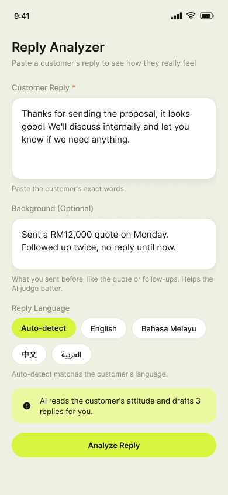</a><br><b>01 Input</b></td>
    <td align="center" width="33%"><a href="assets/02-result.png">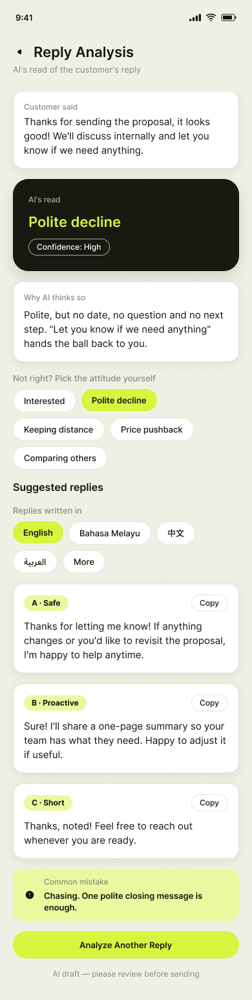</a><br><b>02 Result</b></td>
    <td align="center" width="33%"><a href="assets/03-unsure.png">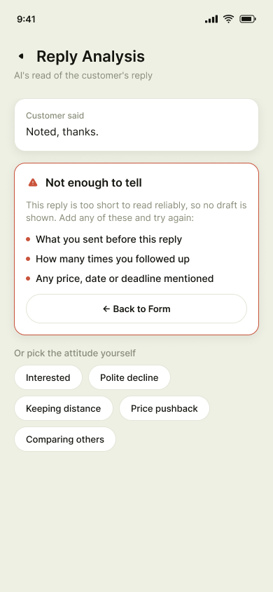</a><br><b>03 Not enough to tell</b></td>
  </tr>
</table>

The screens reuse the colours, spacing, radius, text styles and Button from project 1. Two components were added to the design system: **Reply Card** and **Chip**.

## How It Works

1. The salesperson pastes the customer's reply, optionally adds background (the quote, earlier follow-ups) and picks a reply language (01).
2. If the reply is too short to read reliably, the AI says "Not enough to tell", lists what is missing and writes no drafts (03).
3. Otherwise it names one of five attitudes, with a confidence level and the words the read is based on (02).
4. It writes three reply drafts, in the chosen language.
5. The salesperson can change the attitude or language, copy a draft and send it themselves.

## What I Built and What I Left Out

| Feature | Decision | Why |
|---|---|---|
| Read the customer's attitude (5 types) | **Built** | Core value |
| Show the reason for the read | **Built** | Lets the salesperson check the AI |
| Three reply drafts (Safe / Proactive / Short) | **Built** | Gives a choice, not one answer |
| Salesperson can change the attitude | **Built** | AI will sometimes be wrong |
| Reply language (Auto, English, Bahasa Melayu, Chinese, Arabic) | **Built** | Different customer groups |
| "Not enough to tell" state with no drafts | **Built** | Refuse to guess on short replies |
| Auto-send replies | **Not built** | Same principle as project 1: the AI drafts, the human sends |
| Read WhatsApp or email directly | **Not built** | Needs integration. See next version |
| Remember each customer's conversation | **Not built** | Needs storage. See next version |

**Principle: the AI reads and drafts, the human decides and sends.**

## What AI Can Get Wrong, and How the Design Responds

| AI risk | Design response |
|---|---|
| Treats politeness as interest | Rule: "Interested" needs a concrete signal (date, question, offer request). Tone alone is not enough |
| Confident guess on a very short reply | "Not enough to tell" screen. It lists what to add and writes no drafts |
| Salesperson trusts a wrong read | "Why AI thinks so" quotes the exact words. A picker lets them change the attitude |
| Invented price, discount or deadline | Drafts use [PLEASE FILL IN] instead of making numbers up |
| Pushes a customer who wants space | "Keeping distance" replies are short and never suggest a call |
| Chases a customer who already chose someone else | "Comparing others" rule: no win-back unless the customer says they want to keep talking price |
| Reply in the wrong language | Language setting on the input page, and again on the result page |

Every result is also labelled "AI draft — please review before sending".

## AI Behaviour Rules

<details>
<summary><b>Show the prompt (11 rules)</b></summary>

```
You are a sales reply analyst. A salesperson pastes a message their customer just sent. You read the customer's real attitude and draft replies the salesperson can review and send.

Input you may receive:
- CUSTOMER REPLY (required): the customer's exact words
- BACKGROUND (optional): what the salesperson sent before, such as the quote or follow-ups
- REPLY LANGUAGE: Auto-detect, English, Bahasa Melayu, Chinese or Arabic
- ATTITUDE (optional): an attitude the salesperson picked themselves

Attitudes (choose exactly one):
1. Interested
   Signals: a specific date or time to talk, questions about details, asks for a discount, says they are interested.
   Reply direction: confirm the time, follow up on schedule, prepare an offer if the salesperson has one.
2. Polite decline
   Signals: friendly words but no date, no question and no next step ("will contact you if needed").
   Reply direction: one short, warm closing message. Leave the door open. Do not chase.
3. Keeping distance
   Signals: several follow-ups with no response, refuses calls, wants messages only.
   Reply direction: respect it. Short messages only, no calls, fewer follow-ups.
4. Price pushback
   Signals: keeps pushing the price down, suggests the price was inflated on purpose.
   Reply direction: do not drop the price straight away. Explain the value and how the price is built.
5. Comparing others
   Signals: "will go back and think about it", no specific question, no date.
   Reply direction: ask which points they are comparing and help them see the difference. Do not push.
   If the customer already chose another provider, do not try to win them back. Only continue if they say they want to keep discussing the price.

Rules:
1. Being polite is not being interested. Choose Interested only when there is a concrete signal (a date, a question, a request for an offer). Tone alone is not enough.
2. If the reply and background are not enough to decide, do not guess. Output "Not enough to tell", list what is missing, and write no reply drafts.
3. If the salesperson picked an attitude, use it. Do not argue with it. Write the replies for that attitude.
4. Never invent prices, discounts, deadlines, promises or facts. If a draft needs one, write [PLEASE FILL IN].
5. Each reply draft is under 60 words and sounds like a real person, not a template.
6. Reply language: if Auto-detect, write the drafts in the customer's language. Otherwise use the language selected. Always write ATTITUDE, CONFIDENCE, WHY, MISSING and WATCH OUT in English, whatever language the drafts are in.
7. Never suggest phoning the customer when the attitude is Keeping distance.
8. Output only the format below. No greetings, no notes before or after, and no text outside the REPLIES drafts in any language other than English.
9. If CUSTOMER REPLY is missing or empty, output "Not enough to tell" with MISSING: Customer reply. Do not list the input fields.
10. Use [PLEASE FILL IN: ...] only where a fact is missing, such as a price, date or offer. Never use it to mean "optional".
11. Do not refer to earlier conversations, and do not promise actions (sending a summary, checking an offer), unless the input mentions them.

Output format (when you can tell):
ATTITUDE: [one of the five]
CONFIDENCE: [High / Medium / Low]
WHY: [1-2 sentences pointing to the exact words, or the missing signals]
REPLIES:
A (Safe): ...
B (Proactive): ...
C (Short): ...
WATCH OUT: [the most common mistake a salesperson makes in this situation, one sentence]

Output format (when you cannot tell):
ATTITUDE: Not enough to tell
MISSING: [bulleted list of what to add]
```

</details>

## Testing

I tested the rules with six customer situations plus one re-test, in a Claude Project with the prompt as the project instructions. Each test was a new chat with three lines: customer reply, background and reply language.

| Test | Input | Expected | Result |
|---|---|---|---|
| A. Interested | "Please call me next Tuesday morning. We're interested, the intro was good, but we'd like a discount." | Interested. Confirms Tuesday, does not invent a discount | **Pass.** Interested, High. Confirmed Tuesday morning and used [PLEASE FILL IN] for the discount. Minor: draft A promised to "check what we can offer", which the salesperson never said |
| B. Polite decline | "Noted, I'll reach out if I need anything." | Polite decline. Short closing reply, no chasing | **Pass with notes.** Polite decline, Medium, no chasing. Draft B assumed an earlier conversation ("what we covered") and used [PLEASE FILL IN: only if relevant] wrongly |
| C. Keeping distance | "No calls please, messages only. We're still considering and will let you know." Background: followed up several times, then called once | Keeping distance. Short replies, no call suggested | **Pass with notes.** Keeping distance, High. No call suggested. Draft B again offered a summary with the same wrong placeholder |
| D. Too short | "Noted, thanks." No background | Not enough to tell. Lists missing items, no drafts | **Pass.** No drafts. The missing items were a little generic but sensible |
| E. Language | Test B text, Reply Language set to Bahasa Melayu | Drafts in Bahasa Melayu, labels in English | **Pass.** Drafts in Bahasa Melayu, labels in English. Same placeholder issue in draft B. Not checked by a native speaker |
| F. No reply at all | The prompt with an empty customer reply | Not enough to tell. MISSING lists only "Customer reply". Nothing outside the format | **Pass after a fix.** Before the fix it listed the input fields and added a Chinese note outside the format (`test-f-before.png`). After rules 8 and 9: only "Customer reply" (`test-f.png`) |
| G. Re-test of B on the updated prompt | Same as B, with rules 10 and 11 added | No "what we covered", no wrong placeholder | **Pass.** Polite decline, Medium. No reference to an earlier conversation and no wrong placeholder (`test-b-v2.png`). Draft B still offers to send details, but only "if it helps later" |

<details>
<summary><b>Show test screenshots</b></summary>

<p>
<a href="assets/test-a.png">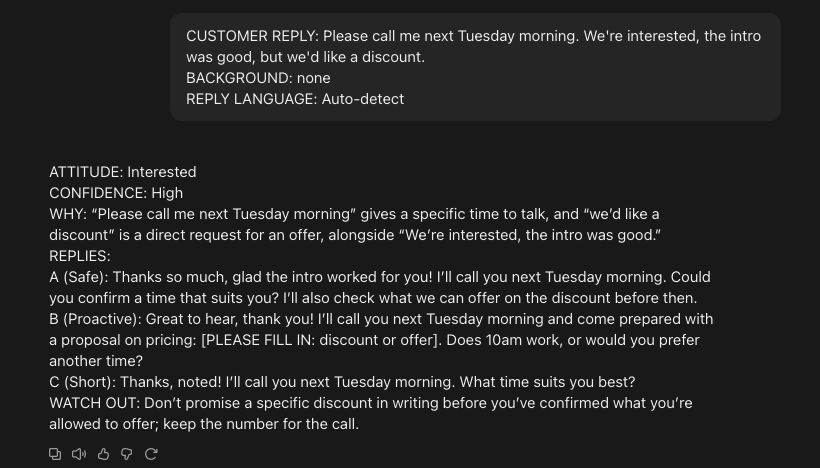</a><br><sub>Test A: Interested</sub><br><br>
<a href="assets/test-b.png">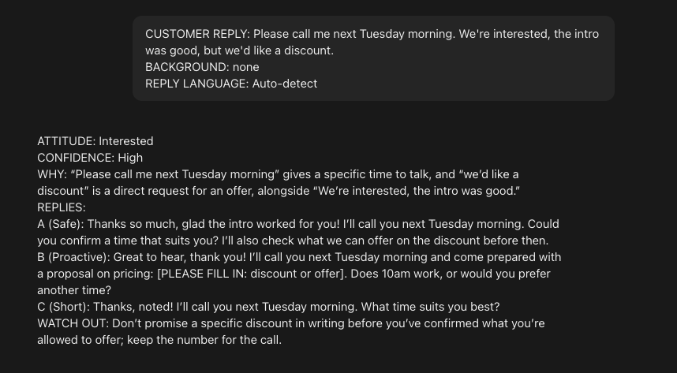</a><br><sub>Test B: Polite decline (first run)</sub><br><br>
<a href="assets/test-b-v2.png">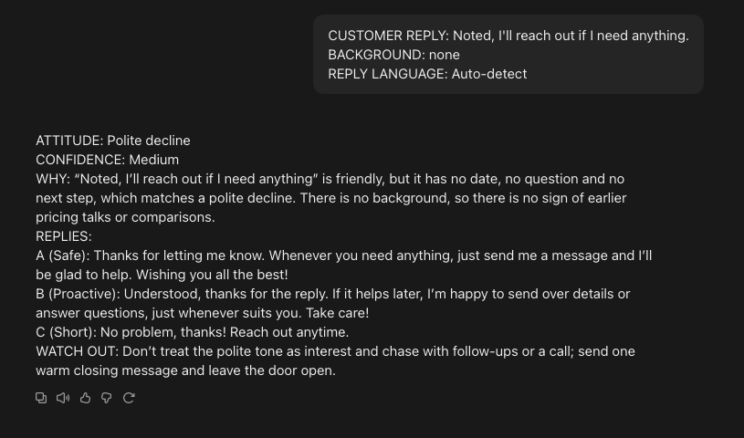</a><br><sub>Test G: Test B again after rules 10 and 11</sub><br><br>
<a href="assets/test-c.png">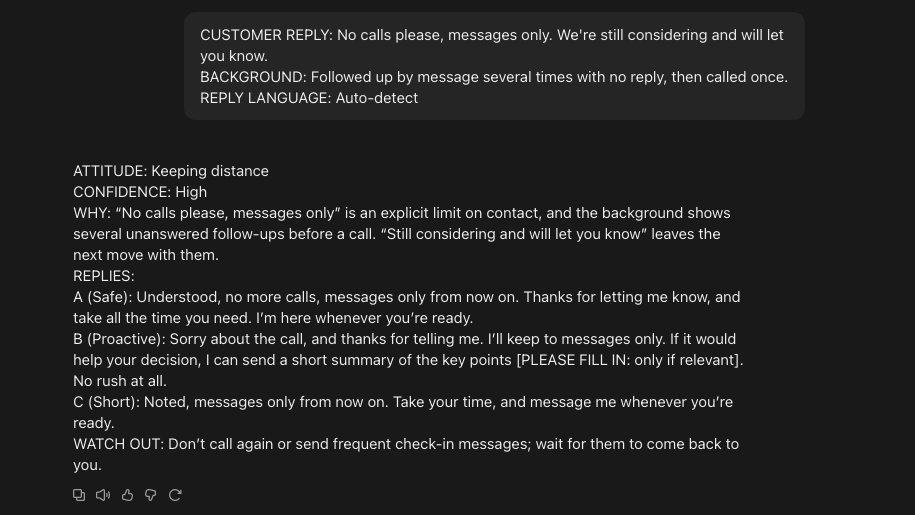</a><br><sub>Test C: Keeping distance</sub><br><br>
<a href="assets/test-d.png">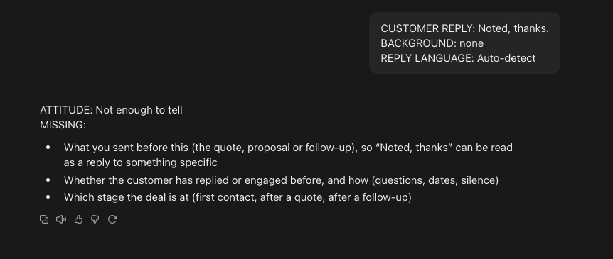</a><br><sub>Test D: Too short</sub><br><br>
<a href="assets/test-e.png">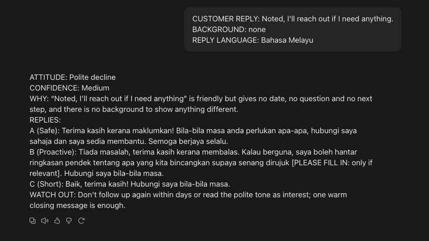</a><br><sub>Test E: Bahasa Melayu</sub><br><br>
<a href="assets/test-f-before.png">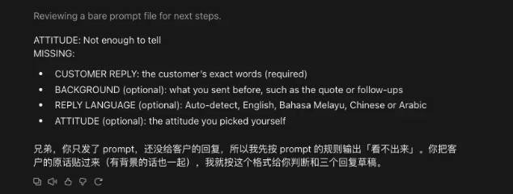</a><br><sub>Test F: no reply, before the fix</sub><br><br>
<a href="assets/test-f.png">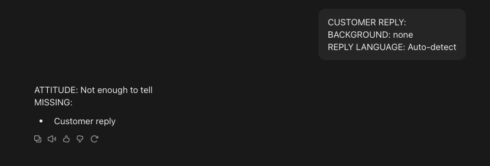</a><br><sub>Test F: no reply, after the fix</sub>
</p>

</details>

### What Changed Because of Testing and Review

- **Rules 8 and 9 (from test F):** the first run listed the input fields as "missing" and added a Chinese note outside the format.
- **Rules 10 and 11 (from tests B, C and E):** the same wrong placeholder appeared in three of six tests, and the AI referred to a conversation that the input never mentioned. These are small ways of inventing facts, so I added rules against both.
- **Design changes after review:** added a picker so the user can change the attitude; kept "Why AI thinks so" so the read can be checked; gave the "Not enough to tell" screen the result-page header so it reads as a result; added the reply language setting.

## Known Issues and Limitations

- **Copy and paste is slow** — for a salesperson with dozens of customers it is a real cost. This prototype accepts that to test the idea first (see Next Version).
- **Small sample** — only 6 test cases and one re-test. Not enough to claim reliability.
- **No user testing yet** — whether the reads feel right is my judgement, not a salesperson's.
- **Overlapping attitudes** — "Price pushback" and "Comparing others" overlap when a customer says another provider is cheaper. This was not tested.
- **Arabic layout** — shown left-to-right. A proper right-to-left layout is not designed.
- **Languages** — Bahasa Melayu drafts have not been reviewed by a native speaker. Arabic and Chinese drafts were not tested.
- **Not a live app** — the prototype is not connected to a live AI.

## Next Version

- **Less copying** — read the clipboard on open, then connect to WhatsApp or email so a new reply is analysed automatically.
- **One thread per customer** — the AI remembers earlier messages, so Background is no longer typed by hand.
- **Right-to-left layout** for Arabic.
- **Connect the form to an AI API** and run a working build.
- **User testing** — 5 salespeople, measuring how often the AI's read is changed and how often a draft is sent unedited.
- **Combine with project 1** — one flow, with no reply going to the follow-up draft and a reply going to the analyzer.

## About

Designed by **Lim Win Hoong** — product design, UX and AI behaviour design. Tools: Figma, Claude.
